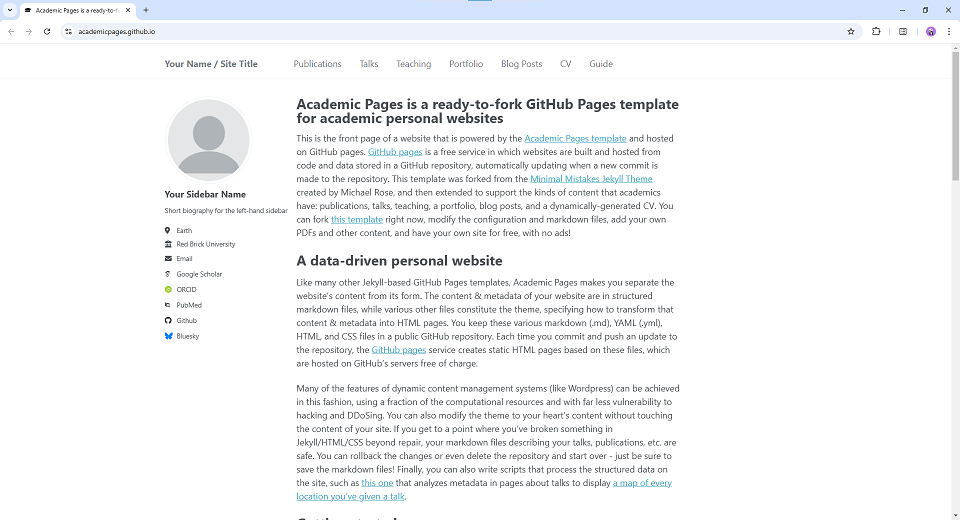

# Academic Pages
**Academic Pages is a GitHub Pages template for personal and professional portfolio-oriented websites.**



# Getting Started

1. Register a GitHub account if you don't have one and confirm your e-mail (required!)
1. Click the "Use this template" button in the top right.
1. On the "New repository" page, enter your public repository name as "[your GitHub username].github.io", which will also be your website's URL.
1. Set site-wide configuration and add your content.
1. Upload any files (like PDFs, .zip files, etc.) to the `files/` directory. They will appear at https://[your GitHub username].github.io/files/example.pdf.
1. Check status by going to the repository settings, in the "GitHub pages" section
1. (Optional) Use the Jupyter notebooks or python scripts in the `markdown_generator` folder to generate markdown files for publications and talks from a TSV file.

See more info at https://academicpages.github.io/

## Running locally

When you are initially working on your website, it is very useful to be able to preview the changes locally before pushing them to GitHub. To work locally you will need to:

1. Clone the repository and made updates as detailed above.

### Using a different IDE
1. Make sure you have ruby-dev, bundler, and nodejs installed
    
    On most Linux distribution and [Windows Subsystem Linux](https://learn.microsoft.com/en-us/windows/wsl/about) the command is:
    ```bash
    sudo apt install ruby-dev ruby-bundler nodejs
    ```
    If you see error `Unable to locate package ruby-bundler`, `Unable to locate package nodejs `, run the following:
    ```bash
    sudo apt update && sudo apt upgrade -y
    ```
    then try run `sudo apt install ruby-dev ruby-bundler nodejs` again.

    On MacOS the commands are:
    ```bash
    brew install ruby
    brew install node
    gem install bundler
    ```
1. Run `bundle install` to install ruby dependencies. If you get errors, delete Gemfile.lock and try again.

    If you see file permission error like `Fetching bundler-2.6.3.gem ERROR:  While executing gem (Gem::FilePermissionError) You don't have write permissions for the /var/lib/gems/3.2.0 directory.` or `Bundler::PermissionError: There was an error while trying to write to /usr/local/bin.`
    Install Gems Locally (Recommended):
    ```bash
    bundle config set --local path 'vendor/bundle'
    ```
    then try run `bundle install` again. If succeeded, you should see a folder called `vendor` and `.bundle`.

1. Run `jekyll serve -l -H localhost` to generate the HTML and serve it from `localhost:4000` the local server will automatically rebuild and refresh the pages on change.
    You may also try `bundle exec jekyll serve -l -H localhost` to ensure jekyll to use specific dependencies on your own local machine.

If you are running on Linux it may be necessary to install some additional dependencies prior to being able to run locally: `sudo apt install build-essential gcc make`

## Using Docker

Working from a different OS, or just want to avoid installing dependencies? You can use the provided `Dockerfile` to build a container that will run the site for you if you have [Docker](https://www.docker.com/) installed.

You can build and execute the container by running the following command in the repository:

```bash
chmod -R 777 .
docker compose up
```

You should now be able to access the website from `localhost:4000`.

### Using the DevContainer in VS Code

Open the repository with **Dev Containers: Reopen in Container**. The site is
served at http://localhost:4000. Source changes are watched with polling, and
changes to `_config.yml` restart Jekyll automatically without restarting VS Code.
Port forwarding only exposes the server; it does not rebuild the site.
Changes to `Gemfile`, `Gemfile.lock`, or the Dockerfile still require a rebuild.
For a standalone Docker session, `docker compose restart jekyll-site` also restarts
Jekyll without rebuilding its image.

#### コンテナを作り直しても Codex の履歴・拡張機能を残す

Dev Container では次のデータをホストの作業フォルダーに保存します。

| 保存対象 | ホスト側の保存先 |
| --- | --- |
| Codex の設定・認証情報・会話履歴 (`~/.codex`) | `.devcontainer/state/codex/` |
| VS Code Server・拡張機能・拡張機能の状態 | `.devcontainer/state/vscode-server/` |

**既存環境からの初回移行では、リビルドする前に、現在のコンテナのターミナルで実行してください。**

```sh
python3 .devcontainer/preserve-state.py
```

コピー完了を確認してから **Dev Containers: Rebuild Container** を実行します。
会話を続けた場合は、リビルド直前にもう一度コマンドを実行してください。
SQLite データベースはバックアップ API でコピーします。コピー中は別の Codex
セッションでの作業を止めてください。コピー後の更新は次のコピーまで保存されません。
初回リビルド後は永続化先へ直接書き込むため、通常このコマンドは不要です。
リビルド中は接続が切れますが、再接続後に保存済みの会話を開けます。
実行中の応答やプロセスそのものは引き継げません。

保存先は Git と Docker のビルド対象から除外しています。認証情報を含むため、
共有・公開しないでください。このフォルダーを削除したり、別の場所へクローンした
場合は引き継がれません。別のマシンへ移す際は、このフォルダーも安全に移してください。
ホスト側の初期化コマンドは `sh` のある環境（Linux / macOS / WSL）を想定しています。


# Maintenance

Bug reports and feature requests to the template should be [submitted via GitHub](https://github.com/academicpages/academicpages.github.io/issues/new/choose). For questions concerning how to style the template, please feel free to start a [new discussion on GitHub](https://github.com/academicpages/academicpages.github.io/discussions).

This repository was forked (then detached) by [Stuart Geiger](https://github.com/staeiou) from the [Minimal Mistakes Jekyll Theme](https://mmistakes.github.io/minimal-mistakes/), which is © 2016 Michael Rose and released under the MIT License (see LICENSE.md). It is currently being maintained by [Robert Zupko](https://github.com/rjzupkoii) and additional maintainers would be welcomed.

## Bugfixes and enhancements

If you have bugfixes and enhancements that you would like to submit as a pull request, you will need to [fork](https://docs.github.com/en/pull-requests/collaborating-with-pull-requests/working-with-forks/fork-a-repo) this repository as opposed to using it as a template. This will also allow you to [synchronize your copy](https://docs.github.com/en/pull-requests/collaborating-with-pull-requests/working-with-forks/syncing-a-fork) of template to your fork as well.

Unfortunately, one logistical issue with a template theme like Academic Pages that makes it a little tricky to get bug fixes and updates to the core theme. If you use this template and customize it, you will probably get merge conflicts if you attempt to synchronize. If you want to save your various .yml configuration files and markdown files, you can delete the repository and fork it again. Or you can manually patch.

---
<div align="center">
    

[](https://github.com/academicpages/academicpages.github.io/graphs/contributors)
[](https://github.com/academicpages/academicpages.github.io/releases/latest)
[](https://github.com/academicpages/academicpages.github.io/blob/master/LICENSE)

[](https://github.com/academicpages/academicpages.github.io)
[](https://github.com/academicpages/academicpages.github.io/fork)
</div>
